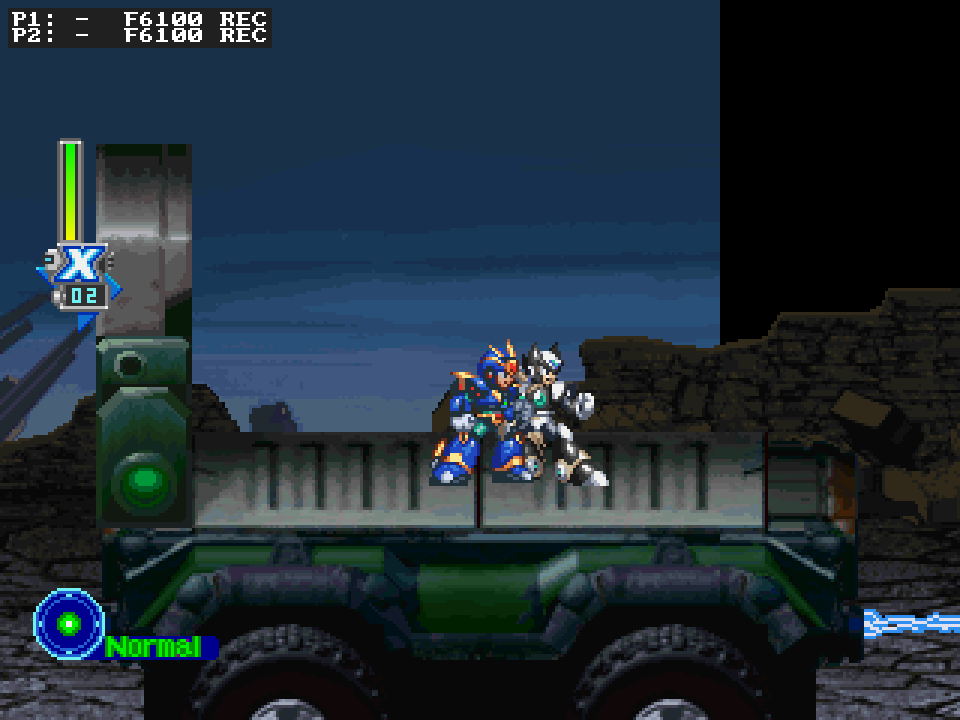
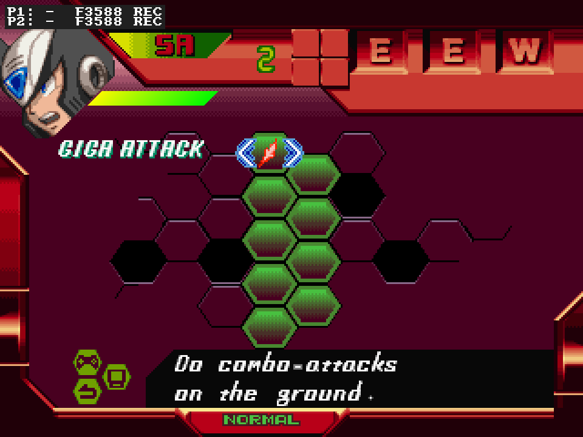

# MegaManX5Recomp

Play Mega Man X5 (USA, SLUS-01334) on PC, with experimental simultaneous
X + Zero co-op. Bring your own game disc; use OpenGL for co-op.

**The current co-op parity campaign is a local development playtest.** It has
not been published as a new release, and full campaign and netplay parity are
still being checked. Start with the [co-op playtest guide](docs/COOP_PLAYTESTING.md).
Older packages have their own [release notes](RELEASE_NOTES.md).



*Actual gameplay on candidate 89E80004, 2026-10-22: Ultimate X/P1 and Black
Zero/P2. This is P1's view during a two-peer test on one PC, with automatic
forms enabled. The original stage loader and HP refill assisted setup; this
capture does not establish route completion or Internet compatibility.*

## Play together

1. Open the local playtest build, select your disc and use **OpenGL**.
   Start windowed with normal audio.
2. In **Mods**, enable **X + Zero Co-op**. Co-op defaults off and needs a
   fresh boot after changing its options.
3. Assign separate P1 and P2 controller devices. For two keyboard players,
   give each seat distinct bindings; the default keyboard layouts overlap.
4. Press **PLAY**, then choose the campaign hero for P1. The other available
   hero joins as P2. See [Controls](#controls) and the
   [playtest guide](docs/COOP_PLAYTESTING.md) for menus, joining and reports.

Unified is the default display. **Local co-op display** offers
**Side by side 8:3 (Experimental)**; **Netplay cameras** separately selects
Unified or Split for online peers. Both players share one campaign and world.
Ride Armor belongs to P1.

**Input Display and Recording** (Playtest Diagnostics) and **Skip Alia Hints**
are enabled by default. Automatic Alia stage hints are suppressed; story,
boss and capsule dialogue remains. Netplay includes diagnostics and always
suppresses those automatic hints.

## Co-op options

These are the current Mods controls. Settings marked experimental still have
open checks; enabling one does not imply full campaign coverage.

| Setting | Default | Effect |
|---|---|---|
| Netplay cameras | Unified | Split gives each peer a separate view of the shared world. |
| Life meter layout | Stacked | Side by side places the two shared-screen meters alongside each other. |
| Local co-op display | Unified | Side by side 8:3 (Experimental) gives each local player a 4:3 pane. |
| Separate E-tank contents | Off | Private E-tank energy; tank acquisition and W energy stay shared. |
| Ultimate Armor X | Off | Select X's native Ultimate Armor without a capsule or a saved unlock grant. |
| Black Zero | Off | Select Zero's native black form without a capsule or a saved unlock grant. |
| Keep Zero playable | Off | Local-only availability override after the story removes P2 Zero. |
| Door and refight entry | Either player | Both players (Experimental) requires living teammates at the same entrance. |
| Co-op boss scaling | Off | Elective damage and recovery adjustments for regular Mavericks and the first Dynamo. |
| Boss hit cooldowns | Separate for each player | With scaling enabled, choose separate recovery or reduced shared cooldowns. |

Boss scaling gives X half native damage and Zero 40%, with shorter ordinary
hit recovery. Other encounters retain native balance. These options still
have open encounter and cooldown checks in the parity burndown.

The two form options work independently and require a fresh boot. For co-op,
use these settings inside **X + Zero Co-op**. The separate **Cheats** entries
with the same names default off and apply to offline single-player play;
online play uses the host's agreed co-op settings. Forms do not grant capsule
rewards or change saved unlock progress. Some form-specific combat and
rewind/rollback checks remain open.

Both-player refight-pad waiting now has a local gameplay check covering waiting,
both-player admission and withdrawal fallback. Online pad admission remains
unverified. The [burndown](docs/COOP_PARITY_BURNDOWN.md) records individual
passes, failures and remaining gaps.

Netplay is available for alpha testing through the launcher's Host/Join flow.
Use the exact same candidate on both peers, with the host's agreed mod choices.
Each peer binds its local device as Player 1; the room assigns the gameplay
seat. Internet transport and full campaign play are not certified.



*P2's own menu on the same candidate. The player who opens a menu controls it;
the current two-peer test checks both menus and return to gameplay. The input
overlay and REC indicator come from the default-on diagnostics.*

## Status

This branch preserves the local X5 co-op parity work. Native stage entries,
combat, menus, rewards, memory-card save/load and selected transitions have
bounded gameplay evidence. Remaining comparisons and newly discovered issues
are tracked individually; this is not a completed parity or all-stages claim.

The current candidate has a successful combined two-peer test of automatic
forms, arrivals, movement and attacks, effects, both menus, Nova Strike with
an independently moving partner, Alia hint suppression, train scrolling, and
survivor control after a scene owner's death. This was a local test using two
copies of the same build. The bundled launcher's actual device assignment,
control display and settings have separate coverage: actual Mods clicks and
PLAY save the choices, a fresh launcher reloads them, and native forms, local
displays and Both-door behavior match. The control pages show the stock
bindings. No gamepad was connected for that hidden, muted check; physical
two-device input and an owner-facing window/audio handoff remain unverified.

A boss-room checkpoint test skipped an earlier door's native background upload,
leaving incorrect scenery. Requesting that native upload restores the room.
The actual earlier-door trigger and broader artwork coverage remain unverified;
this setup does not establish an ordinary-play rendering regression.

Later local candidate 4DB4A5F3 keeps the final boss introduction waiting until
both players clear a Both-player door. Native dialogue and each player's
control recovery are checked; later phases and endings remain open.

Use [COOP_PLAYTESTING.md](docs/COOP_PLAYTESTING.md) for the current local build.
[RELEASE_NOTES.md](RELEASE_NOTES.md) describes historical packaged releases and
may list different options or older savestate limits.

## Features

- **X + Zero Co-op (Alpha).** Optional simultaneous play with separate life
  meters, owned menus and local or online display choices.
- **Custom Renderer.** Enabled by default; Adaptive follows the window.
  Local side-by-side co-op requires this renderer.
- **Playtest Diagnostics.** Default-on input display and local recording,
  including starting cards and mod choices for issue reproduction.
- **Skip Alia Hints.** Default-on suppression of automatic stage hints;
  original story and upgrade conversations remain.
- **Fast Asset Loading.** Default-on verified asset transfers through the
  original callbacks. Movies, music and background actor loads keep their
  original paths.
- **Launcher and controller support.** Disc/BIOS and memory-card selection,
  controller assignment and display settings. A DualShock/analog controller
  is presented by default.

OpenGL is the co-op validation target. Other renderer and presentation
combinations retain their own coverage limits.

## Setup

### Packaged build

1. Extract the local playtest package supplied for this session. For older
   published packages, follow their accompanying release notes.
2. Run `MegaManX5Recomp.exe`. A **launcher window** opens.
3. OpenBIOS is included and selected automatically. You may optionally choose
   a legally obtained retail PlayStation BIOS.
4. Set the game **disc**: select your legally obtained Mega Man X5 (USA,
   SLUS-01334) disc image. The launcher verifies the ISO9660 header, region, and
   serial.
5. Optionally adjust renderer, supersampling, screen look, and controller
   settings, then press **PLAY**. Your choices are remembered.

Accepted disc formats: `.cue` + `.bin` (preferred — pick the `.cue`) and `.bin`.
**Do not convert the disc to a 2048-byte "cooked" `.iso`** — that discards the
Mode-2 Form-2 XA sectors MMX5 streams its FMV/audio from. If the header or game
ID does not match `SLUS-01334`, the launcher warns and tries to run it anyway.

Selected paths and settings persist next to the executable. Clearing the BIOS
row returns to OpenBIOS.

### Building From Source

<details>
<summary>Developer toolchain and build commands</summary>

Builds on **Windows (MSYS2/MinGW)**.

Requirements:

- A C/C++ toolchain (MSYS2 `mingw-w64-x86_64`) and CMake 3.20+.
- Mega Man X5 (USA, SLUS-01334) disc image (`.cue` + `.bin` or `.bin`). Not
  included. Verify it against `DISC.md` before reporting regressions.
- A retail Sony BIOS is optional; redistributable OpenBIOS is included.
- The `psxrecomp` framework available at the sibling path `../psxrecomp` (linked
  in as the `psxrecomp-v4` junction at the `psxrecomp-v4.pin` SHA), plus a
  recompiled BIOS in `psxrecomp/generated/` (see the framework README).

The recompiler needs the game's PS-X EXE extracted from the disc. A helper is
included:

```sh
python3 ../psxrecomp/tools/extract_psx_exe.py "mmx5/Mega Man X5 (USA).bin" SLUS_013.34 mmx5/SLUS_013.34
```

Generate the recompiled C, then build and run:

```sh
# Regenerate generated/SLUS_013.34_{full,dispatch}.c from the disc/EXE.
#   Windows: pwsh tools/regen.ps1
#   (or invoke the recompiler directly:
#    ../psxrecomp/recompiler/build/psxrecomp-game.exe --config game.toml)

cmake -S . -B build -G "Unix Makefiles"
cmake --build build -j16
./build/mmx5-runtime.exe
```

To build the redistributable Windows release (regens, builds with the launcher,
bundles assets + cache, and zips it): `pwsh tools/package_release.ps1`.

</details>

## Configuration

Launcher choices persist to `settings.toml`; base defaults are in `game.toml`.
Use Mods for the game-specific features listed above. Co-op display, door and
resource options require a fresh boot.

- `[video]` controls renderer, resolution, filtering and FMV preferences.
- `[controller]` controls analog presentation and deadzone.
- `[runtime]` includes BIOS and overlay-cache configuration.

Test-only teleport/HP fixtures are not ordinary gameplay controls.

## Controls

The stock in-game layout uses Cross to jump, Square for the primary attack,
Circle to dash, Triangle for X's selected special weapon, and L1/R1 to cycle
weapons. Saved in-game control changes take precedence.

| PSX button | Keyboard |
|---|---|
| D-Pad Up / Down / Left / Right | Arrow keys |
| Cross | X |
| Square | Z |
| Circle | S |
| Triangle | A |
| L1 / R1 | Q / W |
| L2 / R2 | E / R |
| Start | Enter |
| Select | Right Shift |
| Fullscreen | F11 / Alt+Enter |

A game controller (Xbox, PlayStation, or any SDL-recognized pad) is supported via
SDL when connected. MMX5 expects an analog pad, so a DualShock/analog controller
is presented by default.

| PSX button | Xbox controller |
|---|---|
| D-Pad Up / Down / Left / Right | D-pad or left stick |
| Cross | A |
| Circle | B |
| Square | X |
| Triangle | Y |
| L1 / R1 | LB / RB |
| L2 / R2 | LT / RT |
| Start | Menu |
| Select | View / Back |

The package includes `input.ini` for gamepad defaults. Keyboard bindings are
stored in `keybinds.ini`; each seat needs distinct keys for simultaneous
keyboard play. Check both players in the launcher's controller setup.

Either player can press Start for their own menu; the player who opened it
owns its controls. Hold P2 Select to withdraw, then release and press Select
to request a rejoin near P1 when safe. Withdrawal is unavailable during the
forced Ride Chaser sequence.

## Memory cards and savestates

Use the game's native **SAVE** and **LOAD** for campaign progress. Standard PS1
`.mcd` / `.mcr` cards are managed in the launcher; keep a backup before alpha
testing. The co-op package uses an isolated mod save profile. P1 owns the
shared campaign, while P2's private in-session resources are not a second
campaign save. The original game can reset consumable contents on card Load.

Co-op savestates and rewind are available for current-build testing, with
remaining refusal/restore checks. Treat these states as disposable: use the
same executable and mod settings, and keep native card saves for durable
progress. See the [playtest guide](docs/COOP_PLAYTESTING.md#saving-and-restoring)
for the distinction.

Cards, states and diagnostics are local artifacts and must not be committed.

## Engineering background

<details>
<summary>Framework, performance and source-development notes</summary>

This repository contains the game-specific configuration, seeds, tools, and
build glue for running Mega Man X5 on the PSXRecomp framework. The game's MIPS
code is machine-translated ("recompiled") ahead of time into native C, then
compiled into a Windows program that runs the game's own logic with the
framework's PS1 hardware simulation (GPU, SPU, GTE and memory cards) and BIOS
support.

It does **not** contain the Mega Man X5 disc image, the PS1 BIOS, generated game
code, or any decompiled game C. Those are produced locally from your own legally
obtained assets.

Important files:

- `game.toml`: runtime / recompiler / video / controller config.
- `seeds/`: Ghidra-derived function starts and game-specific seed data.
- `tools/regen.ps1`: regenerates the recompiled C output.
- `tools/package_release.ps1`: builds the redistributable release zip.
- `psxrecomp-v4.pin`: framework commit this project is known-good against.
- `ISSUES.md`: game-specific issue log.
- `DISC.md`: source-disc identity and verification hashes.

## Help make your game faster — just by playing

**Why isn't the game already at full speed everywhere?** Most of MMX5's code is
converted ("recompiled") into a fast native program ahead of time. But
PlayStation games don't keep all of their code in memory at once — they stream
extra chunks of code off the disc as you reach new areas (these chunks are
called *overlays*; MMX5 streams most of its game logic from `ROCK_X5.DAT` /
`ROCK_X5.BIN`). We can't convert a chunk we've never seen, and the only way to
see it is for someone to actually visit that area. Until then, that area's code
runs in a slower compatibility mode.

**Releases ship a head start.** The `cache` folder next to the executable
contains pre-converted native code for areas covered so far, and that work is
reused across launches. While you play, the runtime records newly visited areas
into `overlay_captures.json` and your own cache grows automatically.

**Please do not post `overlay_captures.json` publicly.** It contains verbatim
snapshots of the game's code read from your disc, which is copyrighted material —
keep it on your own machine, alongside your disc image.

## Project background

> _This recompilation is a **byproduct of developing
> [psxrecomp](https://github.com/mstan/psxrecomp)** — the games are the proving ground, the framework is the goal.
> **These are in-development previews, not finished ports — expect rough
> edges**, and depth will keep landing over months, not days. My time for any
> one title is limited, so I ask for your patience. Contributions are welcome —
> testing, issues, and PRs to the game or framework all help and will
> accelerate this game's polish. More on the why at:
> [Recomp + AI: 5 Months Later »](https://1379.tech/recomp-ai-5-months-later/)_

## Development Rules

- Use the real recompiled BIOS and real hardware simulation in PSXRecomp.
- No HLE BIOS shims, no stubs, no fake events, no hand-edited generated files.
- Framework changes go in `mstan/psxrecomp`, not here.
- Game binaries, generated code, memory cards, Ghidra databases, and build
  outputs stay local.
- See `CLAUDE.md` for project-specific rules.

</details>

## License

PolyForm Noncommercial 1.0.0. See [LICENSE](LICENSE).

Mega Man X5 is copyright Capcom. This repository contains no original disc,
BIOS image or extracted game data. The gameplay screenshots depict Capcom's
copyrighted artwork. Release packages contain no original game assets or disc
data. They include the MIT-licensed OpenBIOS; a retail BIOS is never included.
The
release executable and the bundled `cache` folder do contain statically
recompiled (machine-translated) builds of the game's code, the same distribution
model used by other static recompilation projects such as N64: Recompiled.

---

<p align="center">
  <sub><b>R.A.I.D. — Retro AI Development</b> · a Discord for AI-assisted retro reverse-engineering, decomp &amp; recomp</sub>
</p>

<p align="center">
  <a href="https://discord.gg/Ad9BwSzctP"></a>
</p>

See [original-disc AOT overlays](docs/AOT_OVERLAYS.md) for the reproducible inventory, release audit, and coverage limits.
