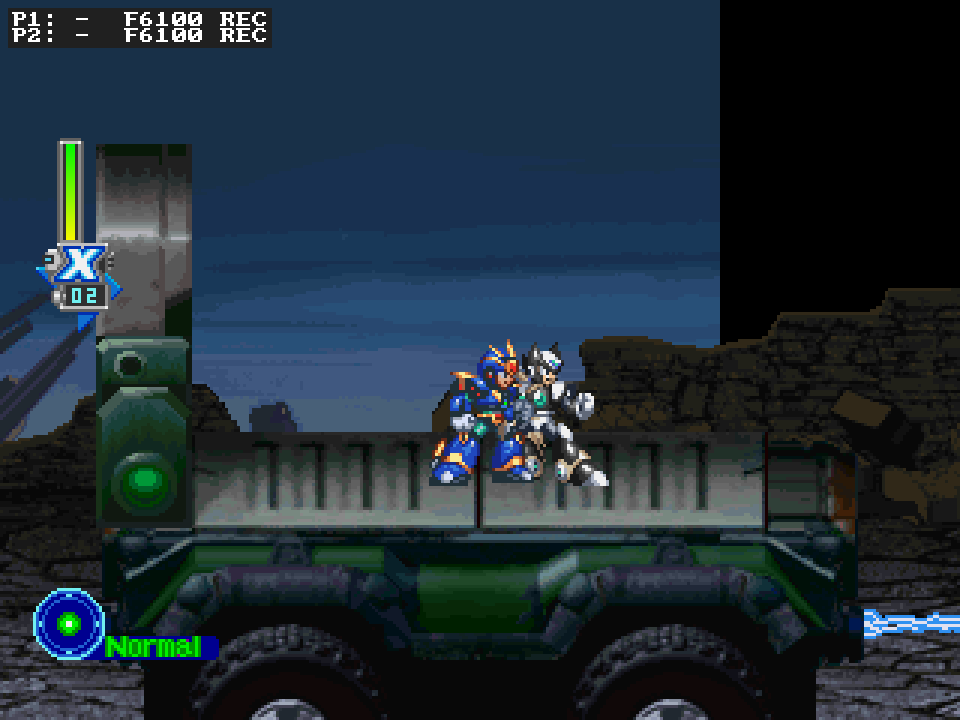

# Mega Man X5 Recompiled

Mega Man X5 on Windows PC, with X and Zero playable together throughout the
campaign. **v1.0 stable** brings the campaign refinements from our co-op testing
into one public release: independent views, personal menus, shared progression,
and polished stage and boss transitions.

Download the [latest release](https://github.com/mstan/MegaManX5Recomp/releases/latest).
You need your own **Mega Man X5 (USA, SLUS-01334)** disc image. OpenBIOS is included.

## Get started

1. Extract the Windows ZIP and run `MegaManX5Recomp.exe`.
2. Select your disc image. For a `.cue` + `.bin` set, select the `.cue`.
3. Assign a separate input device to each player in the launcher.
4. Press **PLAY**, start a campaign, then choose each hero's available form.

OpenGL, co-op, side-by-side views, Alia hint suppression and input recording
are enabled on a fresh install. Custom Renderer uses **Adaptive** to fit the
window; local split-screen gives each player a 4:3 pane. Your saved choices
take precedence when updating.

## Play the campaign together

- **One X, one Zero.** Player 1 chooses a hero and armor; Player 2 chooses a form
  of the remaining hero. Additional forms follow unlocks or the optional codes.
- **Your own view and menu.** Each split-screen pane follows its player and
  shows their life meter. Either player can open their own native pause menu.
- **Refined stage interactions.** Doors, lifts, vehicles, pickups, capsules,
  environmental effects and boss transitions account for both heroes.
- **Shared campaign progress.** Travel through the Maverick stages and final
  stages together, with checkpoints, rewards and native memory-card saves.
- **Local or online.** Play together on one PC, or use the launcher's Host/Join
  flow. Online peers need the same release and compatible mod choices.

The **Mods** page provides co-op camera layouts, door-entry rules, resource
options, armor codes, rendering and diagnostics. Either-player doors are the
default: entering gathers the partner. Both-player entry is also available.
Keep **Skip Alia Hints** enabled for uninterrupted play; enabling those hints
retains the original shared cutscene and its partner-gathering behavior.

See the [co-op guide](docs/COOP_GUIDE.md) for controls, menus, saving and online
setup, and [release notes](RELEASE_NOTES.md) for v1.0.

## Controls

Assign controllers in the launcher before playing. PlayStation, Xbox and other
SDL-compatible controllers are supported. For controller plus keyboard play,
assign the keyboard to one player and the physical controller to the other.
Two keyboard players need distinct bindings.

| PlayStation button | Default keyboard | Action |
|---|---|---|
| D-pad | Arrow keys | Move |
| Cross | X | Jump |
| Square | Z | Primary attack |
| Circle | S | Dash |
| Triangle | A | Special attack |
| L1 / R1 | Q / W | Cycle weapons |
| Start | Enter | Personal menu |
| Select | Right Shift | Select / context action |

In-game control changes take precedence. Use F11 or Alt+Enter for fullscreen.

## Updating and saving

Keep your `saves/` folder and launcher settings when replacing a build. Native
memory cards preserve campaign progress. Save states are specific to a build;
use the game's SAVE and LOAD for progress you want to keep across updates.
No personal saves, settings or game disc data are included in the download.

**Input Display and Recording** is a visible mod, enabled by default. Its local
diagnostics help reproduce problems; you can turn it off in Mods. When reporting
an issue, include the release version, stage, hero assignments and relevant
diagnostics. Keep personal files and extracted game data out of public reports.

## Building from source

This is the game consumer repository. The shared engine and launcher are pinned
Git submodules; initialize them with `git submodule update --init --recursive`.
Windows builds use MSYS2/MinGW, CMake 3.20 or later and Python 3. Supply your own
verified USA disc as described in [DISC.md](DISC.md).

Regenerate the game sources with `tools/regen.ps1`, then configure and build with
CMake. `tools/package_release.ps1 --channel public --platform windows` runs the
shared release packager. Generated game code, disc images, cards and build
outputs remain outside Git. Engine changes belong in
[psxrecomp](https://github.com/RetroPortingToolKit/psxrecomp); launcher changes
belong in [recomp-ui](https://github.com/mstan/recomp-ui).

## License and credits

PolyForm Noncommercial 1.0.0 with a separate permission for voluntary donations
and advertising. See [LICENSE](LICENSE), [PERMISSIONS.md](PERMISSIONS.md) and
[CONTRIBUTING.md](CONTRIBUTING.md). Dependencies retain their own licenses.
OpenBIOS is bundled under its own license; no retail BIOS is included.

Mega Man X5 and its artwork belong to Capcom. This is an unofficial fan project.
Thank you to everyone who tested the campaign and helped refine co-op.
